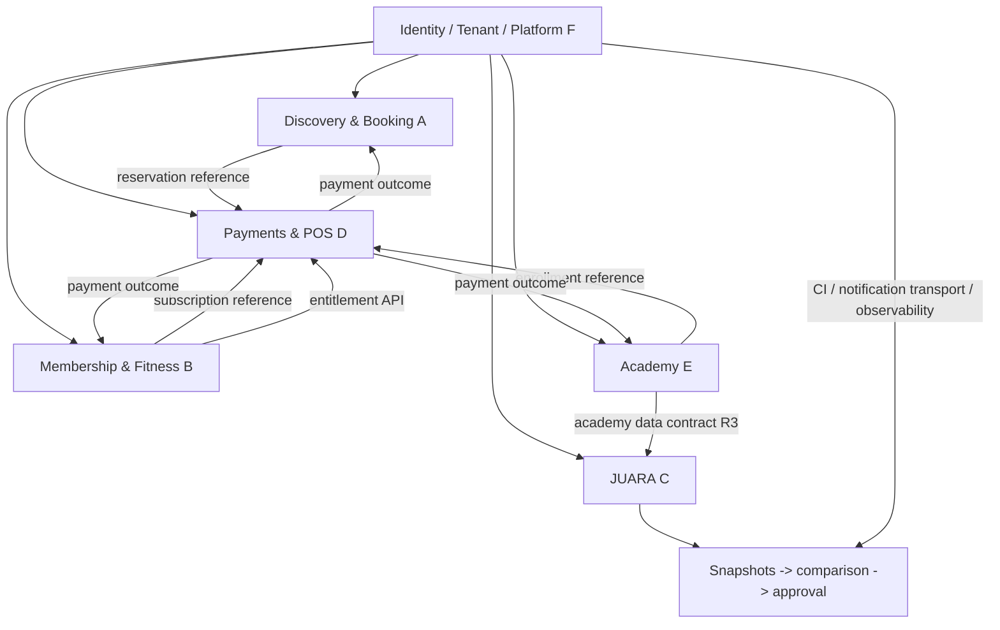

# Feature Dependency Mapping

Domain dependency ≠ kebutuhan menunggu seluruh domain selesai. Kontrak/fixtures
stabil memungkinkan consumer mengerjakan UI/tests paralel. ID rinci dan source
tercantum pada MASTER_FEATURE_INVENTORY.csv serta dua findings inventory.

| Contract | Producer owner | Consumer owner | Batas/jaminan | Bisa paralel |
|---|---|---|---|---|
| Tenant identity/capability | F | semua | server-side scope, deny-by-default | fixtures role/tenant disepakati dulu |
| Reservation/hold/pricing | A | D POS/checkout | immutable quote/reference, expiration, idempotency | POS against contract mock |
| Payment outcome/refund | D | A/B/E | invoice correlation, signed callback, dedup, monotonic states | consumer simulated events sebelum provider UAT |
| Entitlement/check-in | B | D front desk | atomic decrement, repeat-safe, tenant boundary | UI parallel, integration setelah API fixture |
| Student/parent/attendance | E | F identity/C academy bridge | consent/permissions, canonical IDs | JUARA bridge design saja sampaiE stable |
| Club baseline/players | C | C finance/tactics | versioned inputs,27unique vs33coverage | UI synthetic labelled, no production fake KPI |
| Finance forecast | C | C scenario/approval | money precision, no equity-as-revenue | skeleton compare sebelum engine; acceptance menunggu fixtures |
| Shared UI tokens | F custody, B advice | semua/C JUARA | versioned theme, scoped rollout, visual regression | separate feature worktrees, one token merge custodian |
| Migration/CI/release | F coordination | semua | unique IDs, rollback/expand-contract, no shared live DB test | coding parallel, migration sequence serialized |

Critical path existing release: identity/RLS -> verified payment safety ->
booking/member/enrollment payment journeys. JUARA path: safe draft -> accepted
D3 -> baseline/import -> squad -> finance -> snapshot/compare -> governance.
Academy bridge is later; it must not block early JUARA draft or current venue UX.

Cyclic A<->D and B<->D dependencies are resolved with contract/event boundaries,
not by allowing both agents to edit the same tables independently. Producer
exports schema and test fixtures; consumer records failure/retry behavior. PM
tracks dependency task ID, provider/consumer owner, due time and blocked duration.

Readiness before parallel coding: one owner/task, contract inputs/outputs, fixture,
file/table ownership, acceptance test, reviewer and merge order. Hard dependency
unfinished -> consumer may implement against mock but cannot claim integrated pass.
