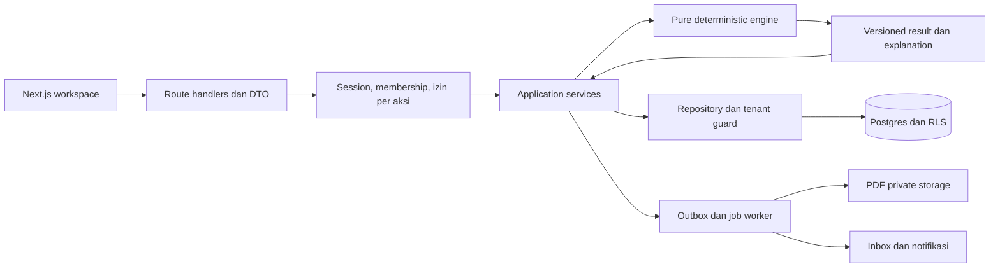

# JUARA — Rancangan Produk, UI, Teknis, dan Pengawasan Owner

Tanggal: 24 November 2026. Status: **RANCANGAN UNTUK REVIEW OWNER**, bukan persetujuan implementasi seluruh roadmap atau klaim rilis selesai.

Penyusun: Codex, Owner Representative. PM pelaksana: OpenCode `ses_dfd621110ffeVnw419vDE4qR43`.

Sumber utama: [Master Blueprint & PRD JUARA](https://docs.google.com/document/d/1YVTwlLKt9C4gkmPBTjmXd_2jIQe6LCREaJxEVZPXHJQ). Dibaca seluruh 11 bagian. Acuan repository: `docs/juara/DECISIONS.md`, `RULEBOOK.md`, `FINANCE_SPEC.md`, `ARCHITECTURE.md`, `PM_RULINGS.md`, kode saat audit, dan balasan PM. Working tree sedang berubah oleh PM; temuan kode adalah snapshot audit, bukan pernyataan keadaan produksi terkini.

## 1. Keputusan produk versi saya

JUARA menjadi ruang kendali keputusan klub: Owner menentukan tujuan; manajemen melihat kemampuan skuad dan kemampuan kas; sistem membandingkan alternatif; keputusan disahkan, ditugaskan, dan diperiksa realisasinya.

Alur utama: **Visi → Baseline klub → Skenario skuad dan uang → Perbandingan → Persetujuan → Rencana kerja → Evaluasi**.

Dalam satu sesi rapat, Owner harus bisa menjawab:

1. Apa target klub musim ini dan tiga musim ke depan?
2. Posisi mana yang menghalangi target tersebut, dan apa bukti kekurangannya?
3. Berapa biaya total keputusan, kapan kas dibutuhkan, dan asumsi pendapatan mana yang rapuh?
4. Mana opsi terbaik: membeli, mempertahankan, mempromosikan, atau meminjam pemain?
5. Siapa bertanggung jawab menjalankan keputusan dan kapan hasilnya diperiksa?

Keunggulan produk adalah hubungan sebab-akibat yang dapat dijelaskan. Mengganti taktik harus mengubah kebutuhan peran; mengganti pemain harus mengubah gaji, amortisasi dan kas; pendapatan sponsor tertunda harus mengubah bulan kekurangan kas. Jumlah pilihan dropdown bukan ukuran kualitas mesin.

Setiap metrik membawa `asOf`, sumber data, status kelengkapan, versi aturan, dan penjelasan perhitungan. Target, proyeksi, dan realisasi diberi label berbeda. Data yang belum ada tampil sebagai “Belum dihitung” dengan tindakan melengkapinya.

## 2. Baseline nyata dan diagnosis kinerja

| Area | Bukti saat audit | Penilaian |
|---|---|---|
| Fondasi | Next.js 16.2.12, React 19.2.4, Supabase, tabel `juara_*`, enkripsi aplikasi | Dipertahankan, tidak perlu rewrite framework |
| Login dan wizard | Rute login, signup, dashboard, vision, arsip tersedia | Fondasi alur ada; baseline input belum lengkap |
| Generator | `src/lib/juara/playbook.ts` mengembalikan total 27, kelompok usia, rentang grade, profil taktik | Belum menghasilkan master plan terintegrasi |
| Finance | `formulas.ts` memiliki beberapa fungsi murni; generator memakai `MENUNGGU_ENGINE` | Belum ada perhitungan keuangan klub lengkap yang terhubung |
| Squad | Tabel slot tersedia; PM mengonfirmasi depth chart dan 22 archetype belum menjadi alur UI | Schema bukan fitur selesai |
| Skenario | ENUM status tersedia; compare, snapshot, lock belum ada menurut PM | Belum memenuhi inti pengambilan keputusan |
| Izin | Helper RBAC ada; PM mengonfirmasi route generate/save/invite belum menerapkan gate per aksi; invite stub | Prioritas pertama sebelum membuka data/aksi baru |
| PDF | Dibangun dari summary/request; metadata pengunduh berasal dari request/default | Belum dokumen resmi dari versi tersimpan dan identitas terverifikasi |
| RLS | Dokumen UAT anon/authenticated tersedia, diakui CTO | Bukti isolasi tertentu; bukan bukti seluruh role/action aman |
| UI | Shell hanya Ringkasan, Owner Vision, Playbook | Belum workstation manajemen klub dalam PRD |
| Verifikasi | PM melaporkan 46 tes lulus, build/lint lulus, deploy R21; visual belum diterima | Implemented/tested/deployed/accepted harus dipisah |

PM mampu menghasilkan fondasi dan merespons koreksi. Kelemahannya adalah ukuran selesai, integrasi fitur, dan pembuktian pengalaman pakai. Menyerahkan penilaian visual sepenuhnya ke Owner membuat Owner menjadi QA utama. Perbaikannya: satu hasil kerja harus mencakup aturan, data, API, UI, dan bukti browser.

Catatan alat: `agent-browser` ditemukan di `/home/taradfs/.nvm/versions/node/v24.16.0/bin/agent-browser`. Temuan ini telah dikirim ke PM. Klaim alat hilang perlu diperiksa dengan path absolut sebelum menjadi blocker.

## 3. Konflik PRD yang harus diselesaikan sebelum implementasi

| Konflik/asumsi | Keputusan rancangan |
|---|---|
| 26–28 pemain, response 27, deskripsi API 28 | `squadSize` eksplisit, default 27; batas mengikuti profil kompetisi/musim yang diverifikasi |
| 11 posisi × 3 lapis = 33, tetapi skuad 27 | Pisahkan **27 pemain unik** dari **33 penempatan coverage**; satu pemain dapat menutup posisi alternatif. Kebutuhan simultan tidak boleh menghitung pemain yang sama dua kali |
| Horizon 1–5 dalam PRD, UI 1/3, proyeksi dokumen 1–3 | Target mendukung 1–5 tahun dengan kalender bulan; pilot 1 dan 3 tahun dahulu, fitur 5 tahun setelah rekonsiliasi lintas tahun lulus |
| Rentang grade tidak menjamin total tepat 27 | Konversi persentase ke bilangan bulat dengan largest remainder; target grade exact harus menjumlah `squadSize`; rentang hanya panduan |
| Rasio usia belum menanggapi DNA di kode | Aturan per posisi, horizon, DNA dan sumber data; perubahan harus menghasilkan diff yang bermakna, bukan pergantian teks |
| 38 laga disebut sebagai asumsi universal | Jadwal dari profil kompetisi dan skenario; menit tim = laga × 90 × 11, per posisi = laga × 90. Contoh 38 laga = 37.620 menit tim |
| Rentang menit semua tier dapat melebihi kapasitas | Alokasi constrained; `sum(minutes)` tidak melebihi kapasitas, batas ketersediaan tiap pemain, konflik diberi alasan infeasible |
| Empat DNA PRD vs sepuluh pilihan PM; False Nine juga peran | Pisahkan game model, preset, formasi, role, duty, instruksi. Pertahankan mapping data lama; jangan langsung menghapus ENUM di produksi |
| Proyeksi pendapatan berdasarkan persentase yang totalnya dapat >100% | Hitung setiap revenue stream dari unit ekonomi; porsi persen adalah hasil, bukan enam target independen yang dijumlahkan |
| Equity dianggap dapat memperbaiki seluruh rasio | Owner equity masuk pendanaan kas, terpisah dari operating revenue dan laba |
| Batas 65% disebut seolah aturan UEFA/AFC/PSSI yang sama | 65% menjadi kebijakan internal default. UEFA 2026 menyebut 70%; jangan mengklaim kepatuhan AFC/PSSI tanpa profil aturan lokal terverifikasi [S2] |
| Penjualan akademi disebut 100% laba bersih | Hitung proceeds bersih, biaya jual, klausul, NBV, pajak sesuai kebijakan. NBV nol tidak menghapus biaya dan pajak. Gain disposal dipisah dari revenue operasional [S3] |
| Enkripsi menjamin admin server tak bisa membaca | RLS adalah kontrol akses, bukan enkripsi. Admin yang menguasai runtime dan kunci tetap bisa mengakses; KMS/pemisahan kewenangan memperbaiki model ancaman, bukan janji absolut |
| Nilai PPDA, usia puncak, ARI dan multiplier dianggap kepastian | Simpan sebagai asumsi/model, sumber dan tanggal; penilaian scouting memiliki ketidakpastian, tidak dipasarkan sebagai fakta objektif universal |
| ACWR/PHV menghasilkan keputusan kesehatan otomatis | Di luar pilot. Data kesehatan anak dan rekomendasi latihan perlu pemilik domain serta kontrol akses khusus; skor tidak otomatis memutus kontrak/kelayakan medis |

Tanggal/pajak, kuota pemain, kontrak anak, solidaritas dan lisensi adalah konfigurasi ber-versi yang harus disahkan ahli terkait sebelum menjadi gate hukum. Rancangan ini tidak menyatakan nilai PRD sebagai aturan hukum yang sudah diverifikasi.

## 4. Ruang lingkup rilis

**R0 — Pemulihan:** status jujur, RBAC per aksi, browser berfungsi, prototipe yang disepakati, baseline dataset, serta definisi selesai.

**R1 — Pilot keputusan klub:** input/import skuad dan baseline, wizard tersimpan, taktik/depth, anggaran bulanan, enam sumber pendapatan, SCR internal, tiga skenario, approval/lock, PDF dari snapshot, inbox tugas dan audit. Satu perjalanan lengkap sebelum banyak modul tambahan.

**R2 — Operasional:** recruitment pipeline, kontrak/renewal, mentor dan pathway akademi, sponsor inventory, actual-vs-plan, notifikasi nyata, izin lebih rinci, multi-club selector bila kebutuhan terkonfirmasi.

**R3 — Integrasi:** academy sync, statistik operator berlisensi, ticketing/merchandise Stadione, SSO lintas aplikasi, telemetry jika penyedia dan hak data tersedia.

Bio-banding, model prediksi harga pemain, kesehatan, otomatisasi keputusan hukum, dan klaim peluang juara tidak menjadi blocker pilot. Full PRD tetap backlog yang dilacak; pemindahan fase harus tertulis, bukan diam-diam hilang.

## 5. Rancangan tampilan: Football Manager untuk ruang direksi

Arahan Owner: Football Manager menjadi acuan utama. Yang dipakai: konteks klub tetap, navigasi berdasarkan pekerjaan, kepadatan tabel, posisi pemain, inspector, drill-down, dan perbandingan keputusan. Pola taktik merujuk manual resmi Sports Interactive [S4]. Mobbin dipakai untuk pola interaksi pendukung, dengan URL layar dan alasan; tidak menggantikan arah FM.

Skill yang dibaca: `/home/taradfs/.opencode/skills/ui-ux-pro-max/SKILL.md`. Hasil pencarian pertama cocok pada **Data-Dense Dashboard**, tetapi template landing “Enterprise Gateway” tidak relevan; hasil retry dark OLED juga tidak sesuai PRD. Keduanya tidak diadopsi sebagai desain utuh. Panduan fokus keyboard, kepadatan, aksesibilitas dan server/client boundary digunakan. Pilihan warna/typografi di bawah adalah keputusan desain JUARA.

### 5.1 Shell lima zona

1. Sidebar 220 px, bisa dipadatkan menjadi 64 px: klub, musim, dan kelompok navigasi.
2. Header 56 px: judul workspace, pencarian, indikator snapshot/draft, identitas pengguna.
3. Tab konteks 40 px: contoh Skuad → Semua pemain / Kedalaman / Kontrak / Jalur menit.
4. Canvas utama: tabel/pitch di kiri, inspector 360–440 px di kanan. Inspector membuka rincian tanpa kehilangan filter/scroll.
5. Action bar 52 px hanya saat skenario diedit: perubahan, dampak, “Bandingkan”, “Ajukan persetujuan”. Padding dan scroll margin mencegah konten tertutup.

Enam indikator kesehatan dibuat ringkas dengan konteks sumber: kelengkapan target, SCR, kas minimum, ruang gaji, usia berbobot menit, horizon. Alignment score baru diaktifkan setelah bobot dan penjelasannya disepakati; tampilkan fakta pembentuknya dahulu.

### 5.2 Navigasi dan halaman

| Halaman | Isi dan aksi utama | Data yang dibutuhkan |
|---|---|---|
| `/juara` — Ruang Direksi | Keputusan prioritas, kas terendah, gap skuad, tenggat kontrak; pilih item untuk inspector | Snapshot aktif, alerts, approvals |
| `/juara/vision` — Visi Klub | Lima langkah, autosave, live summary, baseline vs target, lengkap/belum lengkap | Club/season baseline, vision draft |
| `/juara/playbooks` — Playbook | Daftar versi, status, pembanding hingga tiga skenario | Versions, simulation runs, approvals |
| `/juara/squad` — Skuad | Tabel 27 pemain, filter posisi/usia/grade, depth chart, import | Players, assignments, slots, contracts DTO |
| `/juara/tactics` — Identitas Permainan | Pitch, empat fase, role requirements, auto/manual dengan alasan | Tactical catalog, selected profile, baseline |
| `/juara/finance` — Keuangan | Ringkasan, kas bulanan, biaya skuad, amortisasi, skenario | Cash schedules, cost/revenue lines, policy |
| `/juara/commercial` — Komersial | Enam revenue stream, inventaris sponsor, status contracted/pipeline | Revenue lines, contracts, inventory |
| `/juara/recruitment` — Rekrutmen | Gap → target → evaluasi → persetujuan → negosiasi | Gap result, targets, salary ceiling |
| `/juara/academy` — Akademi | Prospek, mentor, target menit, expiry, evaluasi terukur | Assessments, minutes plan, pairings |
| `/juara/governance` — Tata Kelola | Anggota, izin, approval, audit, konfigurasi | Memberships, audit, rulesets |

Menu pilot hanya memuat halaman yang bekerja. Blueprint menampilkan seluruh tujuan navigasi; fitur yang belum dirilis tidak boleh membuka halaman kosong yang seolah selesai.

### 5.3 Sistem visual

Canvas `#F4F6F5`, panel `#FFFFFF`, sidebar `#112521`, tinta `#172B26`, teks sekunder `#52635D`, border `#DCE3DF`, hijau aksi `#17664C`, emas `#986315`, merah `#B63838`. Status selalu punya teks/ikon, bukan warna saja. Ukur kontras teks sebelum rilis.

Inter/system sans untuk UI; Plus Jakarta Sans untuk judul jika font lokal tersedia; angka tabular. Isi 14 px, tabel 13–14 px, heading 24–28 px. Spasi 4/8/12/16/24/32. Radius panel 8 px, shadow ringan hanya untuk overlay. Ikon Lucide yang sudah ada. Animasi 120–180 ms untuk feedback, reduced-motion, tanpa reveal tabel atau grafik saat scroll.

Desktop 1440: tabel + inspector; 1024: rail ringkas + inspector overlay; 768: satu canvas + drawer; 390/375: daftar ringkas dengan drill-down, kolom penting diprioritaskan. Detail penuh tetap dapat diakses. Jangan memampatkan seluruh meja direksi ke kartu kecil.

### 5.4 Interaksi yang wajib dirancang

- Klik baris membuka inspector; URL menyimpan filter, musim, tab, dan selected ID yang aman. Back mengembalikan konteks.
- Compare menampilkan selisih terhadap baseline dalam Rupiah, menit, dan jumlah gap; bukan sekadar tiga kartu sama.
- Auto-formasi menyajikan tiga kandidat plus alasan. Manual memakai template valid; tidak menerima string sembarang yang panjangnya kebetulan benar.
- Mengubah preset menampilkan preview perubahan dan mempertahankan override yang diketahui, atau meminta tindakan eksplisit untuk reset.
- Total filosofi 100%: nilai sisa terlihat, tombol “Isi sisa ke akademi”, error di dekat input. Tidak mengubah angka pengguna diam-diam.
- Loading memakai skeleton; empty state menjelaskan input pertama; error mempertahankan isian dan tombol retry; izin ditolak menjelaskan siapa yang berwenang; data kedaluwarsa menampilkan waktu.
- Dialog keyboard: focus trap bila modal, Escape, kembalikan fokus ke pemicu; drawer nonmodal desktop punya urutan tab alami. Drag and drop memiliki alternatif tombol.
- Setiap grafik memiliki tabel data, judul, unit, periode, skenario, serta penjelasan sumber. Hindari speedometer besar untuk satu angka SCR; gunakan bar batas yang mudah dibandingkan.

### 5.5 Artefak desain dan gate visual

Prototipe lokal `docs/juara/design/boardroom-prototype.html` memperlihatkan Ruang Direksi, Skuad/Pitch, Keuangan dan perbandingan. Semua nama/angka contoh sintetis, tidak berasal dari klub produksi. Tidak menyimpan persetujuan sungguhan. Inspector prototipe memakai dialog modal pada semua ukuran untuk membuktikan alur/fokus; implementasi desktop final memakai panel nonmodal sesuai §5.1. Sidebar prototipe hanya empat ruang yang dapat dicoba. Wizard, semua state jaringan, dan modul R2/R3 masih berupa spesifikasi, belum interaksi prototipe lengkap.

Sebelum implementasi luas, PM menyerahkan screenshot 1440/1024/768/390, rekaman alur klik, hasil keyboard, empty/error/loading states, dan daftar perbedaan dari prototipe. Owner menilai arah dan mutu; QA membuktikan operasionalnya.

## 6. Alur pengguna dan acceptance perjalanan utama

**Owner pertama kali:** masuk → pilih/buat klub → isi kompetisi/musim → import baseline atau pilih dataset contoh berlabel → lima langkah visi → lihat kekurangan data → generate → inspect masalah → duplikasi skenario → bandingkan → ajukan → setujui dan lock → ekspor.

**Sporting Director:** buka gap posisi → lihat incumbent dan prospek → buat target rekrutmen → simulasi biaya yang diizinkan → kirim proposal; tidak dapat mengesahkan plafon sendiri.

**Finance Controller:** validasi pendapatan/termin → lihat kas dan SCR → stress test sponsor terlambat → cek proposal → beri clearance finansial → Owner menetapkan versi aktif.

**Head Coach:** lihat taktik, peran, kesiapan dan menit; tidak menerima nominal gaji dalam HTML, JSON, cache, export atau browser network.

**Commercial:** role CEO mengelola pendapatan dan inventaris; report sponsor memakai template teredaksi tanpa daftar gaji/kontrak rahasia.

## 7. Arsitektur teknis

Tetap satu repo `stadione-v2`, satu identitas Supabase dan database yang disepakati. Modular monolith lebih mudah dioperasikan daripada microservices untuk kapasitas tim saat ini. Prefix `juara_` dipertahankan; penambahan tabel dibuat melalui migrasi bertahap. Jumlah tabel bukan KPI.



Server Components untuk initial data yang aman; Client Components untuk form, filter, pitch dan simulation interaction. Route handler dan server rendering memakai application service/DAL yang sama. Tidak melakukan fetch HTTP ke aplikasi sendiri dari server hanya untuk mengambil datanya.

Panduan lokal yang dibaca: `node_modules/next/dist/docs/01-app/02-guides/data-security.md`, `01-getting-started/15-route-handlers.md`. DAL hanya server, otorisasi terpusat, minimal DTO. Cache lintas tenant dilarang; private responses `no-store`, invalidasi mengikuti versi dan hak akses. Middleware bukan satu-satunya guard.

Struktur target:

```text
src/lib/juara/
  domain/       money, calendar, tactical-catalog, rulesets, invariants
  engine/       squad, minutes, costs, revenue, cashflow, scr, orchestrator
  application/  create-scenario, simulate, compare, approve, export
  server/       authz, repositories, encryption, audit, jobs
  contracts/    input/output schemas, error codes, DTOs
src/components/juara/
  shell/        sidebar, context-header, health-strip, action-bar
  shared/       data-table, inspector, metric, empty-state, error-summary
  boardroom/ squad/ tactics/ finance/ playbooks/
src/app/api/juara/v1/  adapter kompatibilitas
src/app/api/juara/v2/  kontrak baru, setelah disepakati
```

Tidak memindahkan seluruh file sekaligus. Ekstrak fungsi saat vertical slice menggunakannya. Worker awal dapat proses Node terpisah pada infrastruktur sama, antrean Postgres dengan lease/retry/idempotency; Redis baru jika beban terukur memerlukannya.

## 8. Model data target

Semua entitas klub memiliki `club_id`, timestamps, created_by, dan versi bila mutable. FK lintas entitas tenant memakai pasangan `(club_id,id)` agar row klub A tidak menunjuk player/contract klub B. RLS memverifikasi membership nyata, bukan mempercayai club ID dari request.

| Entitas | Kolom/relasi penting | Catatan implementasi |
|---|---|---|
| `juara_clubs`, `juara_club_members` | user, role, active, club | Retain; invite tidak boleh mempromosikan role sendiri |
| `juara_seasons` | league, date range, match count, registration rules version | Kalender dan aturan kompetisi eksplisit |
| `juara_playbooks` | stable project ID, club, current draft pointer | Root proyek |
| `juara_playbook_versions` | sequence, parent, status, input_enc, output_enc, input_hash, engine/rule versions | Snapshot immutable setelah submit/lock |
| `juara_simulation_runs` | scenario/version, hashes, status, metrics_enc, explanation_enc | Dapat dihitung ulang dari input yang sama |
| `juara_players` | DOB, roles, source, as_of, attributes, confidence | PII terkontrol; data medis terpisah kelak |
| `juara_squad_slots` | version, position, role, target grade, priority | Kebutuhan posisi bukan jumlah pemain unik |
| `juara_squad_assignments` | slot, player, depth, minutes, secondary coverage | Unique constraints mencegah duplikasi yang tidak sah |
| `juara_contracts_vault` | player, dates, terms_enc, key_id, version | Nominal dan nilai turunan sensitif sama-sama dilindungi |
| `juara_finance_lines` | scenario, type, category, recognition schedule, cash schedule, amount_enc | Satu economic item; mencegah fee terhitung dua kali |
| `juara_projections` | version, month, metrics_enc, checksum | Materialized derived output; bukan source of truth |
| `juara_sponsor_inventory` | asset, season, availability, linked agreement | Scope R2 bila pilot cukup input revenue line |
| `juara_recruitment_targets` | gap, role, stage, salary ceiling_enc, assigned_to | Aksi dari gap yang dapat dilacak |
| `juara_academy_assessments` | player, period, components, evaluator, evidence | ARI memuat missingness dan confidence |
| `juara_decisions`, `juara_approvals` | subject version/hash, actor, outcome, reason | Clearance finance terpisah dari owner approval |
| `juara_inbox_items` | source entity, severity, assignee, due_at, resolved_at | Dedup berdasarkan event/aturan/entitas |
| `juara_audit_logs` | actor, action, resource, before/after hash, request ID | Append-only melalui jalur terbatas; tanpa secret |
| `juara_jobs`, `juara_outbox` | event_id, tenant, kind, status, attempts, lease_until | Side effects hanya setelah transaksi commit |

Normalisasi digunakan untuk struktur yang perlu query dan constraint. Snapshot/input fleksibel dapat JSON terenkripsi dengan schema_version. Data finansial terderivasi seperti NBV dan budget harus mengikuti klasifikasi data, bukan dianggap aman karena bukan gaji pokok.

State machine: `DRAFT → SIMULATED → IN_REVIEW → LOCKED_ACTIVE → ARCHIVED`. Perubahan input membuat hasil simulasi lama stale. Penolakan kembali ke draft baru/berversi. Perubahan locked snapshot harus fork; satu versi aktif per klub-musim. Approval menyimpan hash versi, tidak hanya ID mutable.

## 9. Kontrak mesin perhitungan

`simulate(validatedInput, baselineSnapshot, ruleset, clockDate)` adalah fungsi deterministik tanpa akses jaringan, database, random bebas, atau tanggal saat ini terselubung.

Pipeline:

1. Validasi identitas, kelengkapan, kalender dan satuan.
2. Resolve preset taktik menjadi game model, formasi kandidat dan kebutuhan role.
3. Alokasi pemain unik, grade dan usia dengan constraints.
4. Match pemain eksisting ke kebutuhan; hindari double count dalam lineup yang sama.
5. Distribusikan menit dan mentorship; keluarkan konflik bila infeasible.
6. Bangun kontrak/biaya, revenue accrual dan cash schedules.
7. Hitung SCR internal, NBV, P&L, saldo kas, kebutuhan pendanaan tambahan.
8. Terapkan guardrails dan buat keputusan yang perlu review.
9. Keluarkan output + perubahan dari baseline + trace rumus + asumsi.

Input tidak cukup menghasilkan `INCOMPLETE`, bukan 0% SCR/hijau. Model tidak boleh menciptakan nilai kontrak atau target sponsor untuk membuat hasil lolos.

### 9.1 Squad dan tactical engine

- Catalog konfigurasi memisahkan `gameModelId`, `presetId`, `formationId`, 22 role archetype, duty dan phase instructions. False Nine disimpan sebagai role; preset lama dipetakan tanpa kehilangan data.
- `27 × 25/45/30%` menghasilkan `[7,12,8]` melalui largest remainder. Ties memakai urutan stabil. Filosofi sumber pemain dan grade kualitas tidak diasumsikan selalu identik; definisinya disepakati eksplisit.
- Formasi memuat 10 pemain lapangan + 1 kiper, posisi valid, role compatibility. Auto memakai coverage baseline dan bobot preferensi; skor selalu dapat dijelaskan.
- Grade/role fit tidak disimpulkan hanya dari usia. Observasi, menit, league context dan penilaian scouting memuat provenance. Jika kurang data, tampilkan ketidakpastian.
- Pengalokasian menit memvalidasi kapasitas per posisi/pertandingan, availability, loan periods, dan pemain multifungsi. Persentase target tidak boleh secara otomatis mengklaim semua pemain memenuhi menit minimum.
- Gap menghasilkan alasan + opsi, bukan perintah memecat pemain otomatis.

### 9.2 Finance dan commercial engine

- Currency IDR untuk pilot. Nilai uang disimpan sebagai integer unit mata uang atau decimal presisi; API mengirim string nominal. Jangan memakai floating point JS untuk akumulasi buku besar. Persentase memakai basis point, pembulatan hanya pada batas yang ditentukan.
- Pisahkan **cash**, **recognition/P&L**, dan **asset/NBV**. Transfer dicatat di jadwal pembayaran kas; bagian yang dikapitalisasi diamortisasi sesuai kebijakan akuntansi. Tidak dibebankan ganda.
- Fee agen diberi economic category: dikapitalisasi atau expense; bagian yang sudah ada di amortisasi tidak dijumlah ulang sebagai annual agent cost yang sama.
- Jadwal amortisasi mengakomodasi tanggal mulai/akhir, bulan parsial, perpanjangan prospektif, disposal, dan impairment setelah kebijakan ahli disetujui. NBV tidak boleh negatif atau tetap turun setelah umur aset habis.
- Contoh referensi sintetis: Rp1.650.000.000 / 36 bulan = Rp45.833.333,333…; alokasi rupiah dibulatkan dan residual didistribusikan secara deterministik agar total tepat Rp1.650.000.000. Tahun penuh Rp550.000.000.
- SCR internal = biaya skuad eligible / pendapatan adjusted menurut ruleset. Zero/negative denominator menghasilkan `NOT_ASSESSABLE`. Batas warning/breach berurutan dan configurable; tidak melarang Owner memilih batas konservatif di bawah 58%.
- Sponsor: kontrak dan cash due dates terpisah; pipeline probabilistik dilabeli, tidak dianggap kas pasti. Tiket = pertandingan kandang × kapasitas jual × okupansi × harga netto per kelas. Season pass tidak dihitung ulang sebagai tiket pertandingan.
- Merchandise = unit × harga netto dengan COGS terpisah untuk P&L. Penjualan pemain: net proceeds − NBV; academy/community sesuai jumlah peserta dan jadwal. Subsidy/prize money bergantung skenario, bukan pendapatan pasti juara.
- Saldo akhir bulan = saldo awal + operating receipts + financing inflows − cash outflows. Kebutuhan equity adalah top-up minimum terhadap cash floor sepanjang horizon, bukan selisih total tahunan saja. Equity yang direncanakan dan tambahan equity ditampilkan terpisah.
- Skenario downside: sponsor terlambat, okupansi turun, target promosi gagal, bonus naik. Besaran shock adalah input berlabel, bukan prediksi probabilitas.
- Gaya menyerang tidak otomatis menaikkan tiket 20%. Multiplier harus parameter dengan sumber/kalibrasi; default netral sampai bukti tersedia.

### 9.3 What-if dan approval

Simulation mengubah salinan input, tidak data kontrak aktual. Klien dapat preview cepat; server menghitung ulang untuk keputusan. Compare memakai input/ruleset konsisten; jika versi aturan berbeda, perbandingan ditandai.

Approval memakai transaksi: lock versi yang dimaksud, cek membership/role saat itu, cek hash dan data terbaru, validasi guardrail, tulis approval dan active pointer. Dua approver bersamaan tidak bisa mengaktifkan dua versi. Perubahan angka setelah clearance membatalkan clearance lama.

Kebijakan internal merah memblokir approval pada versi itu; Owner dapat merubah kebijakan melalui jalur terpisah yang diaudit dan simulasi ulang. Ketentuan eksternal yang sah tidak dapat di-override sebagai kebijakan internal.

## 10. API target dan validasi

Kontrak baru menggunakan `/api/juara/v2`; v1 tetap adapter sementara. Semua endpoint privat: valid session → club membership → action permission → schema validation → service → DTO minimum. Club yang dipilih harus menjadi membership user; tidak memakai `.limit(1)` tanpa konteks klub jika multi-club diaktifkan.

| Method/path relatif v2 | Fungsi | Akses utama |
|---|---|---|
| `GET /clubs/current` | Profil klub, musim, kemampuan role | Anggota |
| `POST /clubs/:id/invitations` | Undangan token sekali pakai dan expiry | Owner/CEO dengan batas delegasi |
| `POST /players/imports/preview` | Validasi CSV, duplikat, daftar error | Sporting Director/Secretary |
| `POST /players/imports/:id/commit` | Commit batch idempotent | Role yang sama |
| `POST /playbooks` | Buat proyek/draft | Owner/CEO/Sporting Director |
| `PATCH /playbooks/:id/draft` | Save dengan `If-Match`/expected version | Editor berwenang |
| `POST /playbooks/:id/simulations` | Hitung berdasarkan versi/input | Editor berwenang |
| `GET /simulations/:id` | Status/output yang sudah diredaksi | Anggota sesuai scope |
| `POST /playbooks/compare` | Compare hingga tiga snapshot satu klub | Sesuai scope data |
| `POST /versions/:id/submit` | Ajukan review immutable | Editor berwenang |
| `POST /versions/:id/financial-clearance` | Clearance finansial | Finance Controller |
| `POST /versions/:id/activate` | Owner lock/activate | Owner |
| `GET /squad/gaps?versionId=...` | Gap dan alasan | Owner/CEO/SD/Coach |
| `POST /exports` | Queue report dari snapshot, audience template | Role + export scope |
| `GET /exports/:id` | Status dan download setelah re-check izin | Requester/otorisasi saat ini |
| `POST /bridge/:provider/events` | Integrasi bertanda tangan | Integration identity |

Error standar: `401 UNAUTHENTICATED`, `403 FORBIDDEN`, `404 NOT_FOUND` untuk resource tenant lain, `409 VERSION_CONFLICT`, `422 VALIDATION_FAILED/INCOMPLETE_INPUT/GUARDRAIL_BREACH`, `429 RATE_LIMITED`, `503 DEPENDENCY_UNAVAILABLE`. Detail aman + request ID, bukan raw SQL/secret.

Contoh response konseptual:

```json
{
  "schemaVersion": 2,
  "simulationId": "uuid",
  "inputVersion": 4,
  "engineVersion": "1.0.0",
  "rulesetVersion": "internal-id-2026.1",
  "status": "INCOMPLETE",
  "metrics": { "scrPct": null, "minimumCashIdr": null },
  "missingInputs": ["revenue.sponsorship.paymentSchedule"],
  "warnings": [],
  "explanations": [],
  "asOf": "2026-11-24"
}
```

Mutasi kritis memakai idempotency key scoped tenant+actor+operation+payload hash, expiry dan result replay. Error network tidak memicu duplikasi kontrak/approval/export. Webhook memvalidasi signature raw body, timestamp window, event ID, provider dan tenant mapping; replay didedup.

## 11. Keamanan dan hak akses

| Kemampuan | Owner | CEO | Sporting Director | Head Coach | Finance Controller | Secretary |
|---|---|---|---|---|---|---|
| Skuad/taktik | Penuh | Ringkasan | Edit | Edit teknis | Ringkasan | Administrasi |
| Nominal gaji/P&L | Ya | Ya | Pagu posisi | Tidak | Ya | Tidak secara default |
| Draft visi | Edit | Edit | Usulan | Baca relevan | Review biaya | Tidak |
| Clearance finansial | Review | Review | Tidak | Tidak | Ya | Tidak |
| Aktivasi playbook | Ya | Tidak default | Tidak | Tidak | Tidak | Tidak |
| Undang anggota | Ya | Delegasi terbatas | Tidak | Tidak | Tidak | Tidak |

Ini matriks usulan, berbeda dari helper lama yang mengizinkan Finance menyetujui playbook. Owner final approval dan finance clearance dipisahkan sengaja; perubahan dikonfirmasi saat scope pilot dikunci.

RLS membatasi tenant dan aksi relevan; DAL membatasi field. Pengguna tidak boleh bypass UI lewat PostgREST/RPC untuk mengubah role sendiri, active version, approval, audit atau nominal tanpa izin. Uji jalur langsung ini, bukan hanya HTTP route Next.js. `SECURITY DEFINER` hanya fungsi kecil, search_path tetap, grant minimum, identitas dipastikan di server.

AES-256-GCM: key ID, nonce unik, AAD terikat club/table/column/row/version. Server-only decrypt setelah izin diperiksa. Kunci tidak di bundle/browser/log. Rotasi mendukung baca kunci lama dan tulis kunci aktif; uji restore ciphertext+kunci. Runtime root tetap bagian trusted boundary sampai key custody benar-benar dipisah.

PDF dari snapshot tersimpan; nama pengunduh, role dan waktu dari server. Payload tidak dipercaya menentukan watermark/otorisasi. Signed URL singkat dengan private storage; report audience sponsor memakai redaksi. Retensi export dan audit ditentukan pemilik data. Hapus demo credential publik dan akun demo sebelum rilis umum menurut kebijakan yang disepakati.

## 12. Strategi migrasi dan rilis

1. Catat baseline commit lokal/remote/deployed dan migration inventory; jangan menimpa perubahan PM yang belum commit.
2. Tambah schema baru secara additive di staging, constraint/index/FK/RLS bersama migrasinya.
3. Backfill hanya nilai yang dapat dibuktikan; input historis yang tidak pernah tersimpan diberi `legacy_incomplete`. Jangan menciptakan forecast lama.
4. Adapter membaca format lama dan baru; feature flag per klub internal. Satu sumber penulisan selama transisi, hindari dual-write tanpa rekonsiliasi.
5. Jalankan migration rehearsal pada salinan staging yang aman, row counts/checksums, tenant tests, scenario equivalence dan backup restore.
6. Rilis pilot, monitor error dan perilaku; rollback aplikasi tetap mampu membaca additive schema. Penghapusan kolom/ENUM dilakukan fase terpisah setelah seluruh pembaca berpindah.

Jangan deploy otomatis karena dokumen ini tersedia. Deploy mengikuti otorisasi Owner yang berlaku dan gate rilis konkret; tidak perlu meminta persetujuan berulang untuk tindakan yang sudah diotorisasi.

## 13. QA dan bukti penerimaan

| Gate | Bukti yang harus ada |
|---|---|
| Domain | Golden fixtures dihitung independen dari engine; jumlah grade/usia/menit konsisten; NBV tidak negatif; cash reconciliation |
| Security | Peran × aksi × field × tenant; anon, same club, cross club, revoked membership; raw API/RPC dan export |
| Persistence | Save → reload menghasilkan input/output sama; key rotation; snapshot immutable; concurrent approval |
| E2E | Login → baseline/import → wizard → simulate → compare → clearance → lock → reopen → PDF |
| Visual | Screenshot 1440/1024/768/390, inspector, table overflow, loading/empty/error, keyboard, zoom 200% |
| Failure | Timeout, duplicate submit, stale edit, queue retry, dependency outage, partial import, missing key |
| Operational | Restore staging teruji, migration rehearsal, health/alerts, rollback rehearsal |
| Acceptance | Skenario pilot diselesaikan pengguna tanpa bantuan developer; Owner menilai mutu dan prioritas |

Fixture minimum: (A) akselerasi Liga 2 sintetis, (B) stabilisasi tiga tahun dengan sponsor terlambat, (C) academy-first dengan konflik menit/mentor. Data nyata hanya dengan izin dan provenance; data sintetis tidak dilabeli “terkalibrasi klub riil”.

Target performa usulan, diukur setelah baseline: preview lokal p95 ≤150 ms, server simulate p95 ≤750 ms untuk 30 pemain/60 bulan, render interaksi tabel ≤200 ms, export p95 ≤30 detik via queue. Beban awal 20 simulasi bersamaan, 5 export bersamaan. Ukur environment, dataset, p50/p95 dan error rate; target PRD <150 ms tidak dianggap SLA jaringan tanpa pengukuran.

Target operasi pilot: error request privat <1%, tidak ada high/critical terbuka, backup harian; RPO/RTO harus dibuktikan dengan drill (sasaran awal RPO ≤24 jam, RTO ≤4 jam). Kebutuhan lebih ketat mengubah biaya dan infrastruktur.

## 14. Roadmap yang bisa diawasi

Estimasi berikut untuk **satu jalur implementasi efektif** dengan reviewer domain, UI dan QA tersedia paruh waktu. Agent/worker yang kehabisan kuota tidak dihitung sebagai enam divisi aktif. Ini rentang perencanaan, bukan janji tanggal. PM harus mengkalibrasi dari hasil tiga hari pertama.

| Tahap | Estimasi | Deliverable yang bisa dicoba | Dependency/gate |
|---|---:|---|---|
| P0. Baseline dan desain | 2–3 hari kerja | Gap matrix, prototipe empat layar, aturan konflik, working browser | Owner direction + source snapshot |
| P1. Fondasi aman dan shell | 4–6 hari | Role/action gate, server DTO, layout FM, draft autosave | P0, tenant/security tests |
| P2. Baseline dan squad | 6–9 hari | Import preview/commit, players, roles, depth, minutes/gap | P1 + tactical catalog |
| P3. Finansial terhubung | 8–12 hari | Cost/revenue schedules, kas bulanan, NBV, SCR, downside | Data contract P1; domain fixtures; memakai output P2 |
| P4. Skenario dan keputusan | 5–7 hari | Compare 3, review, lock, inbox actions, export | P2/P3 snapshot stabil |
| P5. Pilot dan hardening | 5–8 hari | Tiga journey UAT, role isolation, restore, report, runbook | Semua gate sebelumnya |

Total 30–45 hari kerja sebelum contingency; rencanakan buffer 20–30% untuk integrasi dan review, kira-kira 7–12 minggu pada kapasitas tersebut. Jika kapasitas tim berubah, hitung ulang; jangan menyamakan jumlah sesi agent dengan throughput terukur.

R2/R3 perlu estimasi terpisah setelah pilot; versi lengkap PRD masih proyek lebih panjang. Hari ke-2 harus ada layar dan keputusan desain; akhir P1 harus ada alur aman; akhir P3 harus ada simulasi angka milik input pengguna. Tidak menunggu akhir proyek untuk demo.

## 15. Backlog teknis prioritas

| ID | Pekerjaan | Area file/data | Bukti selesai |
|---|---|---|---|
| GOV-01 | Snapshot baseline + requirement traceability | docs/juara, commit/deploy manifest | Setiap requirement punya state dan evidence |
| SEC-01 | `requireCapability` + tenant context | server-auth, rbac, seluruh route | Role denied 403 dan direct DB bypass ditolak |
| SEC-02 | Invitation nyata, expiry, anti escalation | members/invite + memberships | User sah menerima role; token ulang/expired ditolak |
| UX-01 | Shell lima zona dan design tokens | WorkspaceShell, juara.css | Screenshot responsive + keyboard |
| UX-02 | Shared DataTable/Inspector/states | components/juara/shared | Selection/filter/back/focus konsisten |
| VIS-01 | Draft baseline/wizard lengkap | validation, OwnerWizard, draft API | Autosave/reload; 1/3 tahun; error terlihat |
| DAT-01 | Import players preview/commit | players API/schema | Duplicate/error/partial data tertangani |
| TAC-01 | Catalog game model/preset/role | tactics/domain + compatibility map | False Nine role; formasi valid; legacy terbaca |
| SQD-01 | Unique roster, coverage, minutes | squad engine/slots/assignments | 27 unik, coverage 33, minutes invariant |
| FIN-01 | Money/calendar dan golden fixtures | domain/money, tests/fixtures | Exact rounding dan kalender konsisten |
| FIN-02 | Costs/NBV/cash schedule | engine/costs, finance lines | Cash vs amortization tidak ganda |
| REV-01 | Enam stream + source confidence | revenue engine/finance UI | Harga/volume/termin menelusur ke hasil |
| FIN-03 | SCR/cash gaps/explanations | engine/scr, orchestrator | Null bila incomplete, equity bukan revenue |
| SIM-01 | Simulate/compare immutable inputs | v2 API/version tables | 3 skenario berbeda, baseline tak berubah |
| APR-01 | Review/clearance/activate | approvals/transaksi | Concurrent/stale request aman |
| PDF-01 | Snapshot export + role redaction | export worker/private store | Nilai sama UI, watermark server, layout terbaca |
| OPS-01 | Staging, migrations, restore, telemetry | deployment/runbook | Rehearsal tercatat dan rollback dapat dijalankan |
| QA-01 | Browser flows dan pilot | E2E fixtures/screenshots | QA mengeksekusi, Owner menilai hasil |

Critical path: definisi data/aturan → fondasi akses → baseline → engine → snapshot → approval/export → pilot. Desain dapat berkembang bersama kontrak data; perubahan semantik harus tercatat agar UI dan engine tidak berbeda arti.

## 16. Tiga hari pertama setelah rencana dieksekusi

**Hari 1:** PM mengunci baseline dan daftar gap; reviewer domain memutus 27 vs 33, grade vs sumber pemain, SCR internal, nominal/kalender; UI menampilkan empat layar prototype; browser screenshot tersedia. Owner Representative memeriksa bukti, bukan jumlah commit.

**Hari 2:** implementasi role/action gate dan DTO, test raw DB path; shell FM dibangun pada route yang berfungsi; draft baseline disimpan/reload. Tidak memasukkan KPI contoh ke produksi.

**Hari 3:** satu input klub menghasilkan alur lengkap awal: save draft → hitung bagian yang datanya lengkap → lihat missing data → reopen. Angka fixture diverifikasi independen; PM memperbarui estimasi berdasarkan throughput. Bila belum mencapai ini, kurangi scope slice dan laporkan penyebab terukur.

## 17. Tata kelola PM dan Owner Representative

PM bertanggung jawab terhadap pelaksanaan, dependency, komunikasi blocker, dan kualitas bukti. Owner Representative memeriksa kesesuaian visi, logika, hasil visual dan integrasi; Owner mengambil keputusan produk/anggaran dan penerimaan akhir. Tidak membuat dua jalur perintah kode yang bertabrakan.

Status wajib per deliverable: **PLANNED → IMPLEMENTED → TESTED → DEPLOYED → ACCEPTED**. Tidak setiap deliverable perlu deploy (misalnya desain); status yang tidak berlaku ditandai. “Sprint selesai” tidak boleh menutupi item belum lengkap. Pisahkan accepted teknis, accepted visual dan accepted bisnis.

Format laporan PM:

```text
Target checkpoint:
Hasil yang kini bisa dilakukan pengguna:
Implemented / tested / deployed / accepted:
Bukti: commit, URL/route, dataset, screenshot, test log
Gap tersisa dan dampak:
Blocker: penyebab, upaya, pemilik bantuan, kapan eskalasi
Langkah berikut dan estimasi terbaru:
Keputusan yang benar-benar diperlukan dari Owner:
```

Ritme usulan: update pada setiap hasil kerja bermakna, blocker segera setelah upaya diagnosis terbatas, checkpoint harian ketika pekerjaan aktif, demo dua kali per minggu. PM tidak perlu mengirim laporan kosong berulang. Evaluasi: journey lulus, defect lolos ke Owner, umur blocker, akurasi klaim, dan deviasi estimasi; bukan jumlah test/commit.

WIP maksimum satu slice produk utama + satu perbaikan blocker. File ownership disepakati sebelum kerja bersamaan. Model/layanan berbayar tidak otomatis diizinkan oleh roadmap. Bukti visual dan fakta runtime harus dikumpulkan pelaksana, bukan dialihkan ke Owner.

Pengawasan sesi ini sudah dilakukan lewat pesan langsung ke OpenCode dan balasan PM. Jadwal pemantauan otomatis 24/7 belum dibuat; jangan menganggap dokumen ini sebagai daemon atau recurring job. Cadence di atas adalah prosedur kerja yang akan dijalankan saat sesi/pekerjaan aktif.

## 18. Risiko, asumsi dan keputusan Owner

| Risiko | Pencegahan yang konkret |
|---|---|
| Scope terlalu besar | Pilot satu loop keputusan, R2/R3 terpisah, evidence gate |
| Dataset klub belum ada | Fixture sintetis berlabel untuk engineering; data pilot berizin untuk acceptance bisnis |
| Kualitas domain tidak tervalidasi | Ruleset/provenance dan reviewer olahraga/finance; asumsi bukan fakta |
| Perubahan UI memutus auth/B2C | Prefix/style scope JUARA, route regression, feature flag |
| PM kembali mengejar jumlah fitur | Acceptance journey dan checkpoint dengan bukti browser |
| Integrasi eksternal belum siap | Adapter contract + fixtures, status pending, tidak mengklaim live |
| Kunci dan DB pada server sama | Threat model jujur, least privilege, rotasi/restore; KMS dinilai sebelum enterprise |
| Riset menjadi penundaan | Maksimum tiga pola Mobbin yang bisa diterapkan, lalu prototype dan uji |

Default rancangan: target awal satu klub pilot, antarmuka Indonesia, IDR, desktop/tablet utama, editor 1/3 tahun dahulu, data simulasi terpisah dari aktual, UI editorial terang dengan navigasi hijau gelap. Owner dapat mengubah default saat review; detail engineering rutin ditangani tim.

Keputusan saat review: setujui arah workspace FM, batas pilot, tim/reviewer efektif, dan klub/data untuk UAT. Ini tidak menghambat penyelesaian desain serta spesifikasi yang diminta sekarang.

## 19. Referensi dan batas pembuktian

- **S1:** [PRD Owner](https://docs.google.com/document/d/1YVTwlLKt9C4gkmPBTjmXd_2jIQe6LCREaJxEVZPXHJQ), bagian 1–11. Visi dan requirement; angka referensi tetap perlu validasi domain.
- **S2:** [UEFA 2026 Article 94](https://documents.uefa.com/r/UEFA-Club-Licensing-and-Financial-Sustainability-Regulations-2026/Article-94-Squad-cost-rule-Online?trk=article-ssr-frontend-pulse_little-text-block), batas 70%. Ini tidak membuktikan applicability pada klub Indonesia.
- **S3:** [IFRS Foundation, IASB staff paper February 2025, 17E](https://www.ifrs.org/content/dam/ifrs/meetings/2025/february/iasb/ap17e-summary-other-research.pdf), merangkum keputusan Committee mengenai disposal registration rights sebagai gain/loss, bukan IFRS 15 revenue. Staff paper bukan standar baru; konfigurasi akuntansi tetap memerlukan validasi profesional.
- **S4:** [Sports Interactive FM24 Tactics manual](https://community.sports-interactive.com/sigames-manual/football-manager-2024/tactics-r4960/), pola taktik/preset/instruksi, bukan formula mesin JUARA atau lisensi menggunakan data/aset FM.
- **S5:** Panduan Next.js lokal versi terpasang, skill UI/UX lokal, source repo dan balasan PM sebagaimana dicatat di atas.

Dokumen ini menetapkan rancangan dan acceptance. Ia tidak mengklaim audit menyeluruh terhadap produksi, model olahraga terbukti akurat, atau fitur rencana telah dibuat.

## 20. Review PM dan penutupan rancangan

PM telah membaca rancangan ini dan membalas melalui sesi OpenCode pada 24 November 2026. Ia mengonfirmasi tiga risiko utama: ketepatan engine finansial, otorisasi field/aksi/tenant, serta konsistensi snapshot/approval/migrasi. Estimasi awalnya 15–23 hari dinyatakan terlalu rendah karena belum mencakup QA, security, migration, restore dan review domain. Ia menerima 30–45 hari kerja ditambah buffer sebagai **rentang perencanaan**, bukan komitmen tanggal.

Tambahan gate kesiapan yang disepakati dari review:

| Gate awal | Penanggung jawab yang harus ditetapkan saat kick-off | Bukti/due |
|---|---|---|
| Reviewer finance, sepak bola, aturan kompetisi | PM mencatat nama individu dari Owner/klub; saat ini belum ditunjuk | P0: nama, kewenangan, slot review; target respons 1 hari kerja setelah bahan lengkap |
| Dataset pilot dan provenance | PM mengusulkan data steward klub, Owner menentukan akses | P0: template siap; sebelum P5: dataset berizin dan tanggal validasi bisnis |
| Staging, storage privat, key custody, queue | PM menetapkan pelaksana DevOps efektif | Sebelum P1: akses staging/isolasi; sebelum P4: export worker/storage; sebelum P5: restore drill |
| QA browser | PM tetap accountable bila belum ada QA khusus | P0: browser pulih; setiap slice: evidence browser oleh pelaksana |
| Kontrak v2 dan file ownership | PM + reviewer teknis | Akhir P0: draft kontrak dibekukan; perubahan berikut berupa versioned change record |

Jika reviewer atau data belum siap, engineering boleh berjalan memakai fixture berlabel; acceptance bisnis tetap terbuka. Jika SLA review terlewat, PM melaporkan dampak jadwal dan pekerjaan independen yang bisa diteruskan.

Referensi Mobbin dari PM tersedia di `docs/juara/OWNER_REP_MOBBIN_REFERENCES.md`: Navattic untuk tabel/inspector, Lemni untuk antrean keputusan, Monarch untuk baseline dan perubahan asumsi. Itu adalah hasil riset PM; tidak diklaim sebagai inspeksi screenshot Mobbin mandiri oleh Owner Representative.

Komunikasi yang telah terjadi: permintaan gap dan bukti → laporan PM → penugasan riset UI terbatas + koreksi path browser → hasil referensi/browser → review rancangan dan koreksi estimasi. Pekerjaan aplikasi/produksi tidak diubah oleh penyusunan rancangan ini.
