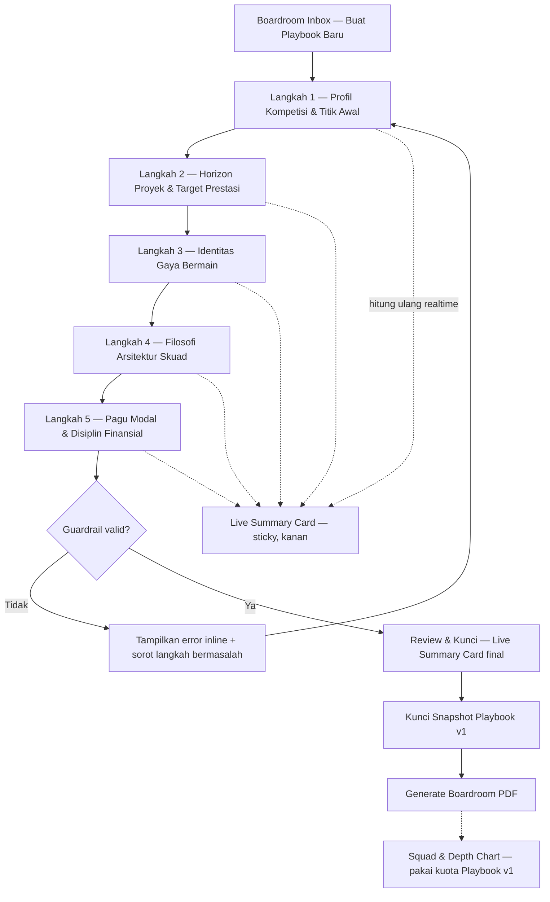

# Spesifikasi UI/UX — JUARA.STADIONE.PRO

**Artefak:** `docs/juara/UIUX_SPEC.md`
**Pemilik artefak:** Worker Divisi 2 — Product UI/UX & Data Visualization
**Rantai komando:** Owner → CTO (`ses_dff75dd2effeCFUgcR7oA66Mu8`) → PM (`ses_dfd621110ffeVnw419vDE4qR43`) → worker ini
**Fokus tunggal (D5):** Information Architecture + design system + 5-Step Owner Wizard + tata letak 5 zona untuk **slice pertama**.
**Status:** spesifikasi untuk di-verifikasi PM. Bukan izin deploy, migrasi, DNS, SSL, push, kredensial, atau kode produksi.

---

## 0. Sumber otoritatif dan klasifikasi keputusan

### 0.1 Hierarki sumber (jangan ditebak ulang)

| Prioritas | Sumber | Yang diambil |
|---|---|---|
| 1 | `docs/juara/PRD-JUARA.md` Bagian 6.1–6.3 | Palet, 5 zona, komponen mikro, 9 ruang kerja |
| 1 | `docs/juara/PRD-JUARA.md` Bagian 2.1 + 2.2 | 5 langkah wizard, age-bracket 25/25/40/10 vs 35/30/28/7, kuota Grade A/B/C |
| 1 | `docs/juara/PRD-JUARA.md` Bagian 7.1–7.2 | Guardrail SCR 3 zona, amortisasi IAS 38 |
| 2 | `docs/juara/DECISIONS.md` D1–D5 | Keputusan CTO atas delegasi Owner (mengikat) |
| 2 | `docs/superpowers/specs/2026-11-22-juara-stadione-pro-design.md` §7 K1–K7 | K5 UI, K6 bahasa, K7 PDF; K2/K3 arsitektur data/auth |
| 3 | Skill `ui-ux-pro-max` | Arah visual & praktik aksesibilitas — **hanya sebagai pendamping, bukan pengganti PRD** |

### 0.2 D1–D3 SUDAH diputuskan — bukan asumsi, tidak dibuka kembali

| Entri | Keputusan tertutup | Perlakuan dalam dokumen ini |
|---|---|---|
| **D1** | Pendekatan B — vertical slice end-to-end; bukan 9 modul UI sekaligus | Dokumen ini hanya menspesifikasi slice: Wizard, Depth Chart, tabel skuad, SCR, PDF. 6 ruang kerja lain **terdaftar, tidak dibangun di slice**. |
| **D2** | Supabase Auth + RBAC 6 peran; SSO menyusul. Gate keras: RLS `club_id` lolos uji cross-tenant + AES-256-GCM di aplikasi sebelum `BYTEA`, di Sprint 1 | Ruang kerja **Club Vault & Governance** hanya menampilkan status RBAC; spesifikasi ini tidak mengusulkan SSO, service_role, atau skema enkripsi alternatif. |
| **D3** | UAT memakai 3 template PRD (1 thn Liga 2; turnaround 3 thn Liga 1; akademi/inkubator) + adapter import terenkripsi sejak sekarang; data klub riil = gate sebelum peluncuran | Semua contoh angka di wireframe memakai **data templatePRD**, bukan data klub riil. |

D4 (satu repo/satu DB/satu `auth.users`, tabel `juara_*` di `schema public`) dan D5 (paralelisasi, satu fokus per worker) juga berlaku dan tidak diubah.

### 0.3 PRD vs keputusan desain worker vs asumsi menunggu Owner

| Kategori | Contoh | Siapa mengubah |
|---|---|---|
| **Spesifikasi PRD (otoritatif)** | Hex #F8FAFC/#FFFFFF/#0F172A/#064E3B/#B45309/#D97706/#059669/#DC2626; 9 ruang kerja; rail 64/220px; ribbon 56px; sub-tab 40px; inspector 440px; bottom bar 48px; 5 langkah wizard; CA/PA; 3 lapis depth chart | Owner/CTO via revisi PRD |
| **Keputusan desain worker (dapat dikoreksi PM)** | Token naming `--juara-*`, grid `minmax(0,1fr) 440px`, tinggi baris tabel 36px, radius 8px, urutan kartu live summary, layout Mermaid/ASCII, peta sub-tab per ruang kerja, turunan netral (#E2E8F0, #475569, #64748B) | PM |
| **Asumsi menunggu Owner/PM** | Hex final untuk status **Oranye 6–12 bulan**; breakpoints tablet/mobile; sumber data Role Familiarity; tampilan live summary saat data template belum tersedia; SSO; deploy `juara.stadione.pro` | Owner/PM (lihat §9) |

### 0.4 Warna status keuangan vs warna milestone juara — WAJIB dibedakan

`#D97706` dipakai PRD untuk **dua peran berbeda**. Pemakaian harus dipisah oleh token, konteks permukaan, dan label — bukan hanya oleh warna.

| Peran | Token | Hex | Permukaan | Penanda wajib (bukan warna saja) |
|---|---|---|---|---|
| Milestone/target juara | `--juara-accent-gold-900` | `#B45309` | Surface terang (Alabaster/Putih) | Ikon bendera + teks "TARGET JUARA" |
| Milestone/target juara | `--juara-accent-gold-600` | `#D97706` | Surface gelap (Carbon Slate/Emerald), mis. ribbon | Ikon bendera + teks "MILESTONE" |
| Status keuangan/kontrak — waspada | `--juara-status-warning` | `#D97706` | **Hanya** surface terang, di dalam badge status | Ikon segitiga + teks "WASPADA" / "12–24 BLN" |
| Status keuangan/kontrak — kritis | `--juara-status-critical` | `#DC2626` | Surface terang | Ikon silang + teks "PELANGGARAN" / "< 6 BLN" |

**Aturan:** `#D97706` tidak boleh muncul dua kali dalam satu komponen dengan dua makna. Di tabel keuangan, `#D97706` selalu berarti **status**; di ribbon bertema gelap, `#D97706` selalu berarti **milestone**. Setiap status tetap menyertakan teks dan/atau pola (garis diagonal), sesuai praktik aksesibilitas yang ditemukan lewat `ui-ux-pro-max` (`--domain chart`: "Do not rely on color alone").

---

## 1. Information Architecture — 9 ruang kerja

Route mengikuti K1/D4: route group `/juara` di repo yang sama, host routing via middleware. Semua ruang kerja mewarisi 5 zona (§3) dan RLS `club_id` (D4/K2).

| # | Ruang kerja | Route | Isi utama (PRD 6.2) | Sub-tab (Zona 3) | Status slice pertama |
|---|---|---|---|---|---|
| 1 | **Boardroom Inbox** | `/juara/inbox` | Pusat keputusan, peringatan kontrak, rekomendasi algoritma | Perlu Tindakan · Riwayat Keputusan | Ringkas (entry point wizard) |
| 2 | **Owner Vision & Playbook** | `/juara/playbook` | Konfigurasi 5 langkah, perbandingan versi skenario, ekspor PDF | Wizard · Versi & Perbandingan · Riwayat Snapshot | **AKTIF — fokus utama** |
| 3 | **Squad & Depth Chart** | `/juara/squad` | Matriks kedalaman formasi, kurva usia, audit skuad | All Players · Tactical Depth Chart · Age & Peak Curve · Contract & Clauses · Mentor-Academy Pairs · Minutes Pathway | **AKTIF** |
| 4 | **Tactics & DNA Matrix** | `/juara/tactics` | 4 fase permainan, PPDA/garis pertahanan, kecocokan peran | In Possession · Out of Possession · Transitions · Role Fit | Terdaftar, tidak dibangun |
| 5 | **Academy & Pathway** | `/juara/academy` | EPA, ARI, Bio-Banding, Loan Army; hook `academy_id` (D4 aturan 7) | Pipeline · Readiness Index · Bio-Banding · Loan Army | Terdaftar, tidak dibangun |
| 6 | **Scouting & Recruitment** | `/juara/scouting` | Matriks target belanja dari celah Playbook, papan negosiasi | Target Board · Gap Analysis · Negotiation | Terdaftar, tidak dibangun |
| 7 | **Finances & SCR Monitor** | `/juara/finances` | CapEx/OpEx, amortisasi IAS 38, arus kas 12 bulan, kontrol SCR | Amortisasi · Arus Kas · SCR Guardrail | **AKTIF** |
| 8 | **Commercial & Sponsors** | `/juara/commercial` | Inventaris aset iklan, rate-card, proyeksi tiket, merchandise | Inventory · Rate Card · Tickets · Merchandise | Terdaftar, tidak dibangun |
| 9 | **Club Vault & Governance** | `/juara/vault` | RBAC 6 tingkat, audit keamanan, integrasi stadione-bridge | Roles · Audit Log · Bridge Status | Terdaftar, tampilan status saja |

**Icon rail:** gunakan satu keluarga ikon vektor (Phosphor utama, Heroicons cadangan), stroke 1.5px konsisten, tanpa emoji. Tiap ikon collapsed memiliki tooltip berisi label ruang kerja.

---

## 2. User Flow — 5-Step Owner Wizard + Live Summary Card

### 2.1 Prinsip

- Wizard adalah **satu halaman dengan 5 langkah**, bukan 5 halaman; navigasi sub-tab tidak memuat ulang (K5/PRD 6.2 Zona 3).
- **Live Summary Card** menempel di kanan (bagian dari Zona 4), menghitung ulang pada setiap perubahan input, memakai angka templatePRD (D3).
- Validasi inline per field; guardrail finansial dicek sebelum tombol **Kunci Snapshot** aktif.
- Seluruh label, placeholder, dan pesan error berbahasa Indonesia (K6).

### 2.2 Diagram alur



### 2.3 Spesifikasi per langkah

| Langkah | Input | Validasi / aturan | Turunan ke Live Summary Card |
|---|---|---|---|
| **1. Profil Kompetisi & Titik Awal** | Kasta: Liga 1 / Liga 2 / Liga 3 / Akademi-Klub Amatir; baseline: jumlah pemain terikat kontrak, rata-rata usia skuad, kondisi akademi/SSB, kapasitas rata-rata penonton kandang | Kasta wajib; angka baseline ≥ 0; usia 15–40 | Badge "Titik Awal", baseline skuad, indikator kondisi akademi |
| **2. Horizon & Target Prestasi** | Skenario: 1 tahun (Akselerasi Instan) / 2–3 tahun (Kontender Terstruktur) / 3–5 tahun (Regenerasi & Inkubator); target terukur per tahun | Durasi harus sesuai skenario; target juara hanya boleh satu per siklus | Age-Bracket Matrix: **25/25/40/10** (1 thn) atau **35/30/28/7** (3 thn); timeline milestone |
| **3. Identitas Gaya Bermain** | 4 tipe: High-Pressing / Positional Play / Vertical Counter-Attack / Balanced Hybrid; nama Direktur Teknik | Pilih tepat satu; teks bebas maks. 60 karakter | Konsekuensi usia lini depan/sayap, alokasi sport science, profil GK/bek/pivot |
| **4. Filosofi Arsitektur Skuad** | Slider rasio sumber pemain; 3 preset: Star-Driven / Balanced Spine + Academy (rekomendasi) / Academy-First | **Total slider harus 100%**; saat satu slider digeser, dua slider lain menyeimbangkan otomatis (PRD Sprint 1, Divisi 4) | Kuota Grade A **6–8**, B **11–13**, C **6–8** (Liga 2, 1 thn); indikator "Spine terkunci" |
| **5. Pagu Modal & Disiplin Finansial** | Owner Equity Injection; target % pendanaan mandiri komersial; batas maks SCR (rekomendasi 60–65%) | Rupiah > 0; pendanaan 0–100%; SCR maks 60–65%; SCR > 58% → badge kuning; > 65% → kunci tombol lanjut | Contoh amortisasi **Rp 1.650.000.000 / 36 bln = Rp 45.833.333/bln = Rp 550.000.000/thn**; status guardrail SCR |

### 2.4 Spesifikasi Live Summary Card

- Posisi: panel kanan Zona 4, lebar 320px saat wizard aktif (di luar inspector 440px), sticky, `top: 96px` (56px ribbon + 40px sub-tab).
- Header: "Ringkasan Playbook — diperbarui langsung" + versi templatePRD yang dipakai.
- Blok berurutan: (1) Playbook Alignment Score `A+…F`; (2) Age-Bracket Matrix 4 bar; (3) Kuota Grade A/B/C; (4) SCR `56,4% / Maks 65,0%` + status 3 zona; (5) Amortisasi contoh; (6) Timeline milestone per tahun.
- Angka memakai Inter/JetBrains Mono tabular; satuan Rupiah diformat `Rp 1.650.000.000` (titik ribuan, koma desimal).
- Status memakai teks + ikon, bukan warna saja. Tombol "Kunci Snapshot" disabled sampai langkah 5 valid.

### 2.5 Wireframe layar wizard (teks)

```
+----------------------------------------------------------------------------------------------+
| ZONA 2 — Top Ribbon 56px: [A+] [SCR 56,4%/65%] [CapEx] [Wage] [24,8 Thn] [Thn 1/3 — Fondasi] |
+----------------------------------------------------------------------------------------------+
| ZONA 3 — Sub-tab 40px: Wizard | Versi & Perbandingan | Riwayat Snapshot                       |
+-------------+----------------------------------------------+-----------------------------------+
| ZONA 1      | ZONA 4 — Form langkah                        | LIVE SUMMARY CARD (320px)         |
| Rail        |                                              |                                   |
| 64/220px    | ① Profil Kompetisi  ② Horizon  ③ DNA          | Ringkasan Playbook                |
|             | ④ Filosofi Skuad  ⑤ Finansial                 | Skor Alignment: A-                |
| [icon] Inbox|                                              | Usia: 25/25/40/10                |
| [icon] Visi*|  Langkah 2 dari 5 — Horizon Proyek            | Grade: A 6-8 | B 11-13 | C 6-8 |
| [icon] Squad|  ( ) 1 thn  (•) 2-3 thn  ( ) 3-5 thn           | SCR: 56,4% / maks 65,0%  AMAN     |
| ...         |  Target: [________________]                   | Amort: Rp 45.833.333/bln          |
|             |  [Sebelumnya]              [Lanjut →]         | [Kunci Snapshot] (disabled)       |
+-------------+----------------------------------------------+-----------------------------------+
| ZONA 5 — Bottom Bar 48px: What-If | Bandingkan Baseline | Kunci Snapshot | Generate PDF          |
+----------------------------------------------------------------------------------------------+
```

---

## 3. Tata letak 5 zona (persistent workspace)

| Zona | Dimensi | Perilaku | Token kunci |
|---|---|---|---|
| **1 — Left Icon-Rail Navigation** | 64px collapsed / 220px expanded | 9 ikon ruang kerja; klik ikon aktif = navigasi; toggle expand di header rail; tooltip saat collapsed | bg Carbon Slate `#0F172A`; aktif Emerald `#064E3B`; teks `#FFFFFF` |
| **2 — Contextual Top Ribbon & Club Health Ticker** | Tinggi 56px | 6 indikator vital real-time; sticky; tiap indikator = label kecil + angka tabular + status dot | bg Carbon Slate; angka `#FFFFFF`; dot `#059669`/`#D97706`/`#DC2626` |
| **3 — Sub-Tab Contextual Ribbon** | Tinggi 40px | Navigasi sub-modul instan tanpa reload; active underline 2px Emerald; horizontal scroll bila > lebar | bg `#FFFFFF`; border bawah `#E2E8F0`; teks aktif `#064E3B` |
| **4 — High-Density Split-Pane Canvas** | Master: `minmax(0,1fr)` · Inspector: **440px** | Klik baris/posisi → inspector slide-over kanan; daftar kiri tetap terlihat; divider 1px `#E2E8F0`; pada ≤1024px inspector jadi overlay | bg canvas `#F8FAFC`; kartu `#FFFFFF`; baris tabel 36px |
| **5 — Bottom Simulation & Action Bar** | Tinggi 48px | Empat aksi: Enter What-If Sandbox · Compare with Baseline Playbook · Lock Playbook Snapshot · Generate Boardroom PDF | bg `#FFFFFF`; border atas `#E2E8F0`; primary Emerald `#064E3B` |

**Skeleton CSS (deskriptif, bukan kode produksi):**

```
grid-template-columns: var(--rail) minmax(0,1fr);   /* --rail = 64px | 220px */
grid-template-rows: 56px 40px minmax(0,1fr) 48px;
zone-2, zone-3, zone-5: grid-column: 2;
zone-4: grid-column: 2; display: grid;
        grid-template-columns: minmax(0,1fr) 440px;  /* inspector */
```

**Aturan Zona 4:** inspector tidak menghapus konteks daftar; tidak ada modal center untuk detail pemain. Scroll konten diberi `padding-bottom` 48px agar tidak tertutup Zona 5.

---

## 4. Design Token — Stadione Pro UI

### 4.1 Token warna FINAL (PRD Bagian 6.1)

| Token CSS | Hex | Peran |
|---|---|---|
| `--juara-canvas-alabaster` | `#F8FAFC` | Background kanvas utama |
| `--juara-surface-white` | `#FFFFFF` | Kartu, tabel, inspector, ribbon sub-tab |
| `--juara-ink-carbon` | `#0F172A` | Rail, top ribbon, teks utama, bottom bar |
| `--juara-brand-emerald` | `#064E3B` | Aksen utama, state aktif, tombol primer |
| `--juara-accent-gold-900` | `#B45309` | Milestone/target juara di surface terang |
| `--juara-accent-gold-600` | `#D97706` | Milestone/target juara di surface gelap |
| `--juara-status-safe` | `#059669` | SCR zona hijau; kontrak > 24 bulan |
| `--juara-status-warning` | `#D97706` | SCR zona kuning; kontrak 12–24 bulan |
| `--juara-status-critical` | `#DC2626` | SCR zona merah; kontrak < 6 bulan; DEPTH DEFICIT |
| `--juara-status-orange` ⚠ | `#EA580C` | **USULAN worker, menunggu Owner** — kontrak 6–12 bulan (Wajib Negosiasi). PRD menyebut "Oranye" tanpa hex. |

Turunan netral (keputusan desain worker, bukan warna merek baru): `--juara-border #E2E8F0`, `--juara-divider #F1F5F9`, `--juara-text-secondary #475569`, `--juara-text-muted #64748B`.

### 4.2 Aturan pemakaian warna

- Surface Alabaster : Putih ≈ 70:30. Emerald dipakai maks. ~10% area untuk aksen/state.
- Emas hanya untuk target juara/kuota Grade A/milestone strategis — **bukan** indikator kesehatan finansial.
- Merah hanya untuk pelanggaran atau risiko nyata; tidak dekoratif.
- Kontras: teks utama `#0F172A` di `#FFFFFF`; teks putih di `#0F172A`/`#064E3B`. Minimum 4.5:1 untuk teks, 3:1 untuk border/ikon bermakna.
- Focus ring: `outline 2px #064E3B`, offset 2px. State hover/active tidak menggeser layout.
- `prefers-reduced-motion`: transisi inspector ≤150ms dinonaktifkan.

### 4.3 Tipografi

| Peran | Font | Weight | Ukuran | Keterangan |
|---|---|---|---|---|
| Judul halaman / KPI besar | **Montserrat**, fallback Plus Jakarta Sans | 700–800 | 24 / 32px | Angka KPI memakai tabular numerals |
| Sub-judul, tombol, label | **Plus Jakarta Sans**, fallback Inter | 600 | 14px | — |
| Teks isi | Plus Jakarta Sans, fallback Inter | 400–500 | 13px | Line-height 1.5 |
| Tabel kepadatan tinggi | **Inter**, fallback JetBrains Mono | 400–600 | 12px | `font-variant-numeric: tabular-nums` wajib |
| Angka keuangan/gaji/amortisasi | **JetBrains Mono**, fallback Inter tabular | 400–500 | 12px | Digit sejajar vertikal |
| Keterangan, badge | Inter | 500 | 11px | Uppercase hanya untuk status |

### 4.4 Spacing, radius, elevasi

- Skala 4 / 8 / 12 / 16 / 24 / 32px (ritme 4/8).
- Radius: kartu 8px, badge 4px (pill untuk status), input 6px.
- Border 1px `#E2E8F0`; shadow kartu `0 1px 2px rgba(15,23,42,.06)`.
- Tinggi baris tabel 36px (dense), header 32px sticky.

### 4.5 Komponen mikro (PRD 6.3)

| Komponen | Spesifikasi |
|---|---|
| **Objective Ability Badge** | CA (`A+, A, B+, B, C`) dan PA (`A+, A, B`, hanya < 23 thn). Dua badge terpisah; **dilarang** bintang subjektif. CA dari level kompetisi + menit 2 musim + statistik kunci; PA dari ARI + kurva fisik. |
| **Contract Timeline Bar** | Hijau `#059669` > 24 bln · Kuning `#D97706` 12–24 bln · Oranye `#EA580C` 6–12 bln ("Wajib Negosiasi", ⚠ menunggu Owner) · Merah `#DC2626` < 6 bln ("Zona Bosman"). Lebar bar proporsional terhadap 36 bln; label bulan + pola garis diagonal menyertai warna. |
| **CIES Career Curve Indicator** | Empat fase: Pre-Peak Rising · Prime Window · Late Prime · Transition/Mentor Phase. Ditampilkan sebagai batang + teks fase; posisi relatif terhadap puncak usia per posisi. |
| **DEPTH DEFICIT** | Kotak posisi tanpa Lapis 2 atau Lapis 3 menyala `#DC2626` + label "DEPTH DEFICIT" + tautan "Buat Target Rekrutmen". |
| **Inline sparkline** | Arus kas 12 bulan / tren SCR; garis Emerald, titik terakhir ditekankan; selalu disertai nilai teks. |
| **Slide-Over Inspector** | 440px, masuk dari kanan, menimpa sebagian kanvas; menutup dengan Esc/tombol; fokus keyboard masuk ke inspector lalu kembali ke baris asal. |

---

## 5. Wireframe slice pertama

### 5.1 Tactical Depth Chart — 2-deep + 1 U21 shadow

Formasi contoh: **4-3-3 DM Wide**. Setiap slot memuat 3 lapis.

```
                             [ST]
                    [LW]             [RW]
                          [CM] [DM] [CM]
              [LB]       [CB]  [CB]       [RB]
                             [GK]
        (atas = arah serangan; setiap slot = tumpukan L1/L2/L3)

 SLOT: RW — Sayap Kanan
 +----------------------------------------------------------------------+
 | L1 STARTER    Budi T.   23  [A]  CA A  / PA A    Role 86%  30 bln #### |
 | L2 ROTATION   Rendi    21  [B]  CA B+           Role 71%  14 bln ###   |
 | L3 U21 SHADOW Farhan   18  [C]  CA C  / PA A+  ARI 85     38 bln ##### | mentor: Budi T.
 +----------------------------------------------------------------------+
 Jika L2 atau L3 kosong -> merah #DC2626 + "DEPTH DEFICIT" + "Buat Target Rekrutmen"
```

- L1 = Starter Grade A/B; L2 = Rotation/Backup Grade B; L3 = Shadow Prospect Grade C U-21 (mentee dari L1).
- Role Familiarity 0–100% ditampilkan angka, bukan bintang.
- Sisa kontrak memakai Contract Timeline Bar (§4.5).
- Kecocokan peran mengikuti DNA yang dipilih di Langkah 3 wizard.

### 5.2 Tabel skuad — Contract & Peak-Age Heatmap Bar

```
| Pemain          | Pos | Usia | CA/PA  | Kontrak (bulan)         | Peak-Age (CIES)          | Gaji/bln (tabular) |
|-----------------|-----|------|--------|--------------------------|--------------------------|--------------------|
| Rizky Pratama   | ST  | 24   | A+ / A | ############### 30 H     | Prime Window        ▓▓▓  | Rp 480.000.000     |
| Budi T.          | RW  | 23   | A / A  | ######## 18 A            | Pre-Peak Rising     ▓▓▒  | Rp 310.000.000     |
| Rendi           | RW  | 21   | B+ / B | ####### 14 A             | Pre-Peak Rising     ▓▒░  | Rp 145.000.000     |
| Farhan          | RW  | 18   | C / A+ | ################## 38 H  | Pre-Peak Rising     ▓░░  | Rp 40.000.000      |
| Pak Dwi (Mentor)| CB  | 31   | B / —  | ## 7 O                   | Transition/Mentor   ▒░░  | Rp 220.000.000     |
+----------------------------------------------------------------------------------------------+
Legend kontrak: H=#059669 (>24)  A=#D97706 (12-24)  O=#EA580C (6-12, ⚠)  R=#DC2626 (<6)
Legend peak  : ▓ Prime/ Rising   ▒ Late Prime       ░ Transition/Mentor
```

- Header sticky; sort multi-kriteria; filter posisi/grade/usia; klik baris → Inspector 440px.
- Status selalu memiliki label teks (`H/A/O/R` dan nama fase), warna bukan satu-satunya pembeda.
- Kolom uang memakai JetBrains Mono tabular; tidak ada data klub riil (D3).

### 5.3 Tata letak PDF eksekutif (K7: jsPDF + autotable, watermark kerahasiaan)

```
+--------------------------------------------------------------------------+
| A4 potret 210x297mm | margin 12mm | header 10mm | footer 10mm (hlm x/y)   |
| Watermark dinamis 45deg tiap halaman: "RAHASIA — <nama_pengunduh> | <peran> | <stempel_WIB>" #0F172A @ 8% [R13] |
+--------------------------------------------------------------------------+
| COVER     : Judul Playbook, nama klub (templatePRD), versi, tanggal        |
| HAL 1     : Ringkasan Eksekutif — 6 indikator dari Top Ribbon             |
| HAL 2     : Owner Vision — ringkasan 5 langkah + target juara              |
| HAL 3     : Age-Bracket Matrix (25/25/40/10 atau 35/30/28/7) + Grade A/B/C|
| HAL 4     : SCR 3 zona + amortisasi IAS 38 (contoh Rp 45.833.333/bln)      |
| HAL 5     : Tactical Depth Chart — LANDSCAPE 297x210mm, 2-deep + U21       |
| HAL 6     : Roadmap 12 bulan + guardrail + 3 opsi remediasi SCR           |
| LAMPIRAN  : Asumsi templatePRD, sumber rumus, daftar istilah              |
+--------------------------------------------------------------------------+
```

- Tabel memakai autotable dengan header berulang di tiap halaman; baris genap Alabaster.
- Font: Montserrat untuk judul, Inter tabular untuk angka; fallback Helvetica bila font tidak tersedia.
- Watermark memakai Carbon Slate, **bukan** ungu/neon; seluruh teks Bahasa Indonesia.
- Pdf tidak boleh berisi data klub riil sebelum gate D3.

---

## 6. Aturan eksplisit

1. **TANPA ungu gelap, hijau neon, atau magenta ala game.** Dilarang: ungu gelap (mis. `#2D1B69`, `#4C1D95`), hijau neon (mis. `#22C55E`, `#00FF00`), magenta (mis. `#FF00FF`, `#D946EF`), glow/gradient HUD, dan latar gelap dominan. Palet hanya seperti §4.1.
2. Catatan verifikasi skill: `ui-ux-pro-max --design-system` mengembalikan gaya **Dark Mode (OLED)** dengan aksen `#22C55E` — **DITOLAK** karena melanggar PRD 6.1 dan aturan ini. Yang dipakai dari skill hanya praktik aksesibilitas (heatmap perlu legenda + nilai teks, tidak bergantung pada warna) dan ritme spacing.
3. **Bahasa Indonesia** di seluruh antarmuka (K6), terminologi mengikuti PRD: Playbook, Squad Cost Ratio, Depth Chart, Grade, Academy Readiness Index, dan sebagainya.
4. **Tidak ada bintang subjektif** — pakai CA/PA objektif (PRD 6.3).
5. **Tidak ada emoji sebagai ikon**; ikon vektor satu keluarga, stroke konsisten.
6. **Warna bukan satu-satunya pembeda status** — selalu ada teks, ikon, atau pola.
7. Read-only terhadap kode produk; tulis hanya di `docs/juara/`. Dilarang migrasi/apply DB, deploy, DNS, SSL, push, restart container, kredensial, data klub riil, perubahan kode produksi.

---

## 7. Handoff ke frontend — definition of done slice

- [ ] 9 entri IA tersedia sebagai rute `/juara/*`; 3 aktif, 6 ber-status "terdaftar".
- [ ] 5 zona terpasang dengan tinggi/lebar sesuai §3; inspector 440px tidak menghilangkan konteks daftar.
- [ ] Wizard 5 langkah dengan live summary card; slider rasio total 100%; tombol kunci disabled sampai valid.
- [ ] Token §4.1 terdaftar sebagai CSS variable; tidak ada hardcode hex di komponen.
- [ ] Depth chart 3 lapis + DEPTH DEFICIT; tabel skuad dengan dua batang mikro + legenda teks.
- [ ] PDF eksekutif dengan **watermark dinamis per halaman** (nama pengunduh, peran, stempel WIB), header berulang, angka tabular, tanpa data riil [R13].
- [ ] Verifikasi build/lint/test oleh frontend dengan bukti exit code sebelum klaim selesai (PRD §8).

---

## 8. Verifikasi artefak (bukti)

Dijalankan dengan protokol skill `verify` (evidence gate): perintah dijalankan segar, output dibaca, klaim hanya dibuat setelah output cocok. Karena deliverable berupa dokumen (bukan kode), pembuktiannya adalah pemeriksaan isi artefak dan batas wewenang — bukan test suite aplikasi.

**Perintah 1** — `python3` pemeriksaan isi artefak (dijalankan segar dari root repo):

```
FILE=docs/juara/UIUX_SPEC.md EXISTS=True LINES=357 BYTES=26816
HEX #F8FAFC: count=3   #FFFFFF: count=8   #0F172A: count=6
HEX #064E3B: count=7   #B45309: count=4   #D97706: count=15
HEX #059669: count=5   #DC2626: count=8   #EA580C: count=4 (berlabel ⚠ menunggu Owner)
MERMAID_BLOCKS= 1
WORKSPACES_MISSING= []
DIMENSIONS_MISSING= []        # 64px, 220px, 56px, 40px, 440px, 48px
WIZARD_STEPS_MISSING= []      # Langkah 1..5
D1_D3_DECIDED_SECTION= True
OWNER_PENDING_SECTION= True
NO_REAL_CLUB_DATA_RULE= True
CJK_OR_STRAY_CHARS= []
```

**Perintah 2** — pemeriksaan warna terlarang (dijalankan ulang dengan konteks kalimat, karena kemunculan boleh hanya sebagai larangan/penolakan):

```
#2D1B69: occurrences=1 all_in_prohibition_or_rejection=True
#4C1D95: occurrences=1 all_in_prohibition_or_rejection=True
#22C55E: occurrences=3 all_in_prohibition_or_rejection=True
#00FF00: occurrences=1 all_in_prohibition_or_rejection=True
#FF00FF: occurrences=1 all_in_prohibition_or_rejection=True
#D946EF: occurrences=1 all_in_prohibition_or_rejection=True
```

Interpretasi: tidak ada warna terlarang yang dipakai sebagai token; semua kemunculan berada di §6 butir 1 (daftar dilarang), §6 butir 2 (penolakan rekomendasi `ui-ux-pro-max`), atau ringkasan §10.

**Perintah 3** — batas wewenang: `git status --short && git diff --stat` menghasilkan `M .gitignore` (+1 baris `graphify-out/`, dari hook graphify, **bukan tulisan worker ini**) dan `?? docs/` (berisi artefak worker ini `UIUX_SPEC.md` serta artefak worker lain: `PM_LOG.md`, `RULEBOOK.md`, `SECURITY_QA_PLAN.md`, `PM_RULINGS.md`). Tidak ada file kode produk, migrasi, konfigurasi deploy, atau kredensial yang diubah oleh worker ini.

**Batas klaim:** ini adalah verifikasi artefak dokumentasi. Tidak ada test suite aplikasi yang dijalankan, sehingga tidak ada klaim "build/lint/test lulus" untuk kode produksi. Sesuai aturan `verify`, klaim dibatasi pada perintah yang benar-benar dijalankan dan output yang benar-benar dibaca di atas.

---

## 9. Hal yang tidak bisa diputuskan worker — diteruskan ke Owner/PM

1. **Hex final status Oranye (6–12 bulan).** PRD 6.3 menyebut "Oranye" tanpa kode warna; worker mengusulkan `#EA580C`. Perlu keputusan Owner/PM agar tidak bentrok dengan Gold `#D97706`.
2. **Breakpoint tablet/mobile.** PRD hanya menetapkan ukuran desktop (64/220/56/40/440/48). Perilaku ≤1024px (inspector jadi overlay) baru merupakan usulan worker.
3. **Sumber data Role Familiarity 0–100%** dan CA/PA — apakah dihitung Divisi 1/Rulebook atau input manual? Menunggu `RULEBOOK.md`.
4. **Tampilan live summary card sebelum data templatePRD tersedia** — placeholder atau kosong? Menunggu keputusan PM.
5. **SSO `auth.stadione.pro`, DNS/SSL, deploy, kredensial, data klub riil** — tetap butuh lampu hijau Owner terpisah (D2/D3/§"Masih butuh lampu hijau Owner").

---

## 10. Ringkasan laporan ke PM

**Laporan Spesifikasi IA & Design System Slice Pertama**
**Konteks:** Menyusun spesifikasi UI/UX yang bisa dipakai frontend tanpa menebak, untuk slice pertama JUARA.

- Artefak `docs/juara/UIUX_SPEC.md` berisi IA 9 ruang kerja, alur 5-Step Wizard + live summary card, 5 zona (64/220, 56, 40, 440, 48), token warna/tipografi final, dan 4 wireframe (wizard, depth chart, tabel skuad, PDF).
- D1–D3 dicatat sebagai keputusan CTO tertutup, bukan asumsi; data contoh memakai templatePRD (D3), bukan data klub riil.
- Pemisahan eksplisit: warna status keuangan (`#D97706` sebagai "waspada") vs milestone juara (`#B45309`/`#D97706` dengan ikon bendera + konteks permukaan).
- Aturan "TANPA ungu gelap/hijau neon/magenta" ditegakkan; rekomendasi Dark Mode + `#22C55E` dari `ui-ux-pro-max` ditolak dan dicatat.
- 5 butuh keputusan Owner/PM dirinci di §9 (utama: hex Oranye 6–12 bulan).
